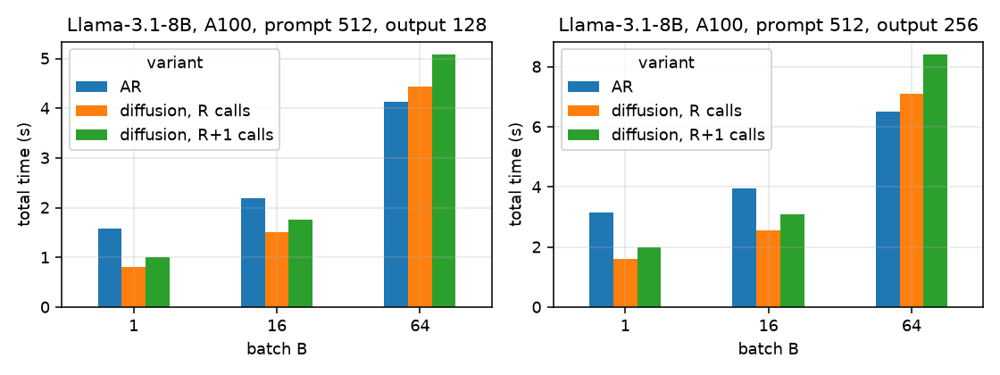
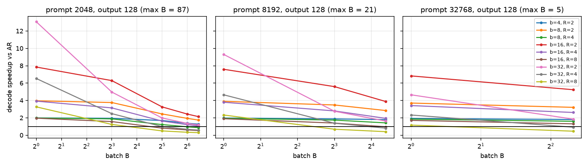
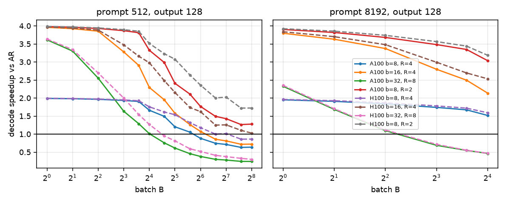
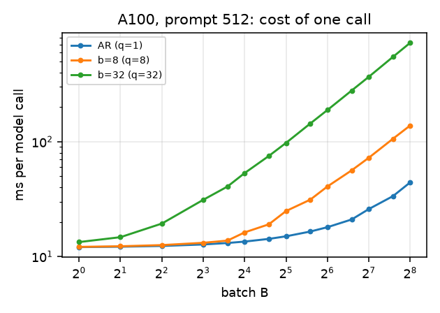

# ECE201C Project 3: Block-diffusion LLM decoding in RAPID-LLM

All numbers are RAPID-LLM analytical estimates (simulated A100 80 GB unless stated; no real GPU
was used). Model: Llama-3.1-8B (`configs/model-config/course_project/Llama3.1-8B_inf.yaml`),
hardware: `configs/hardware-config/course_project/a100_80GB_1gpu.yaml` (unedited).

## 1. What is modeled

A block-diffusion LLM writes its `O` output tokens in blocks of `b` tokens. Each block starts as
`b` masked positions and is refined over `R` model calls. Every call processes all `b` positions at
once and attends to the KV cache of all earlier text (prompt + finished blocks) plus,
bidirectionally, the `b` positions of the current block. When the block is done it joins the prefix.

| | Autoregressive (AR) | Block diffusion |
|---|---|---|
| positions per call (q) | 1 | b |
| calls | O | (O / b) · R (or · (R+1), see below) |
| context of a call | S + t + 1 for step t | S + (k+1)·b for every call of block k |
| weights + KV read | once per call | once per call |
| FLOPs per output token | 1 position-pass | R (or R+1) position-passes |

**Calls per block: R or R+1.** PROJECTS.md says a block is refined over R calls; the class slides add
one more call per block that stores the finished block's K/V. Both are implemented
(`kv_save_pass: false` = R calls, the default; `true` = R+1). The extra call is priced as a full
call (it could skip the LM head and last-layer FFN, so R+1 is a slight upper bound).

**Out of scope (as the slides state):** text quality, how many rounds a real model needs, and
confidence-based early exit. R is an input.

## 2. Implementation

All inputs are in the model YAML (course helper H1):

```yaml
project_param:
  decode_schedule: block_diffusion   # default: autoregressive
  block_size: 8                      # b
  refine_rounds: 4                   # R
  kv_save_pass: false                # true = R + 1 calls per block (slides' variant)
  decode_head_all_rows: false        # true = output head priced for all B*q rows (§6)
```

| File | Change |
|---|---|
| `llm_util.py` `autoregressive_decoder_gemm` | Helper H2: every per-token GEMM (QKV, out-proj, FFN, router, LM head, MLA projections) gets `q` rows instead of 1; attention GEMMs get `q · shared_heads` query rows against the full context, so weights and KV are read once per call while FLOPs grow with q. |
| `inference_timing.py` `_build_decode_transformer_results` | Layer norms, residuals, activations, MoE token counts and the LM head use `q` positions. |
| `simulate_inference_graph.py` | `BlockDiffusionSchedule` + `block_diffusion_schedule()` parse and validate `project_param` (unknown keys, b not dividing O, R < 1 are errors). `_build_block_diffusion_decode` walks blocks instead of tokens: it prices calls at sampled blocks (first and last by default, every `sample_every / b` blocks otherwise), integrates over the block index with the same trapezoid rule, and charges `calls_per_block` calls per block. |
| `inference_timing.py` `calc_time` / `calc_total_inference_time` | Decode memory peak uses q = b positions of activations; time to first token = prefill + first full block; per-sequence tokens/s = b / (calls_per_block · call time); KV-fetch bytes summed over blocks; a `[diffusion] model_calls=…` summary line. |
| `tests/test_block_diffusion.py` | 14 unit tests: q = 1 shapes unchanged, q scales rows not weights or context, schedule counts, neutral schedule = token loop, bad inputs (unknown keys, quoted booleans) rejected. |
| `course_p3/` | `regress.py` (baseline check), `runner.py`, `evaluate.py` (all runs), `plots.py`, `results/*.csv`, `figures/*.png`. |

## 3. Correctness checks

- **Regression (feature off).** The course branch has no `course/regress.py`, so `course_p3/regress.py`
  records 11 runs before any edit (the four course models — Gemma without its window block — plus the
  Project 3 grid and a run with `sample_every: 16`) and compares every stdout line byte for byte.
  After all edits: **all 11 match**.
- **Neutral setting.** b = 1, R = 1, no save pass must equal AR. Checked at (B, S, O) = (1, 512, 128),
  (64, 512, 256) and (8, 2048, 128, `sample_every: 16`): decode time, prefill time, time to first
  token, max and decode peak memory **all identical**; model calls = O.
- **Unit tests:** `pytest -q` → 50 passed, 2 skipped (36 existing + 14 new).

## 4. Required evaluation

Llama-3.1-8B, A100 80 GB, prompt S = 512, b = 8, R = 4. `R` = R calls per block (PROJECTS.md),
`R+1` = with the save pass (slides). Decode FLOPs are an analytic count (2 · params · positions +
attention), not a RAPID-LLM output.

| B | O | schedule | model calls | decode (s) | **total (s)** | TTFT (s) | ms / call | decode tok/s | decode TFLOP | **peak (GiB)** |
|---|---|---|---|---|---|---|---|---|---|---|
| 1 | 128 | AR | 128 | 1.550 | **1.586** | 0.049 | 12.11 | 83 | 1.96 | 15.14 |
| 1 | 128 | diffusion R | 64 | 0.778 | **0.815** | 0.085 | 12.16 | 164 | 7.84 | 15.14 |
| 1 | 128 | diffusion R+1 | 80 | 0.973 | **1.009** | 0.097 | 12.16 | 132 | 9.80 | 15.14 |
| 1 | 256 | AR | 256 | 3.100 | **3.137** | 0.049 | 12.11 | 83 | 3.93 | 15.14 |
| 1 | 256 | diffusion R | 128 | 1.557 | **1.594** | 0.085 | 12.17 | 164 | 15.72 | 15.14 |
| 1 | 256 | diffusion R+1 | 160 | 1.947 | **1.983** | 0.097 | 12.17 | 132 | 19.64 | 15.14 |
| 16 | 128 | AR | 128 | 1.731 | **2.191** | 0.474 | 13.52 | 1183 | 31.4 | 17.91 |
| 16 | 128 | diffusion R | 64 | 1.041 | **1.501** | 0.525 | 16.26 | 1968 | 125.4 | 17.91 |
| 16 | 128 | diffusion R+1 | 80 | 1.301 | **1.761** | 0.541 | 16.26 | 1575 | 156.8 | 17.91 |
| 16 | 256 | AR | 256 | 3.479 | **3.939** | 0.474 | 13.59 | 1177 | 62.9 | 17.91 |
| 16 | 256 | diffusion R | 128 | 2.094 | **2.555** | 0.525 | 16.36 | 1956 | 251.4 | 17.91 |
| 16 | 256 | diffusion R+1 | 160 | 2.618 | **3.078** | 0.541 | 16.36 | 1565 | 314.3 | 17.91 |
| 64 | 128 | AR | 128 | 2.310 | **4.131** | 1.839 | 18.05 | 3547 | 125.4 | 26.79 |
| 64 | 128 | diffusion R | 64 | 2.613 | **4.433** | 1.983 | 40.82 | 3136 | 501.8 | 26.79 |
| 64 | 128 | diffusion R+1 | 80 | 3.266 | **5.087** | 2.023 | 40.82 | 2508 | 627.2 | 26.79 |
| 64 | 256 | AR | 256 | 4.689 | **6.510** | 1.839 | 18.32 | 3494 | 251.4 | 26.79 |
| 64 | 256 | diffusion R | 128 | 5.277 | **7.098** | 1.983 | 41.23 | 3105 | 1005.8 | 26.79 |
| 64 | 256 | diffusion R+1 | 160 | 6.597 | **8.418** | 2.023 | 41.23 | 2484 | 1257.2 | 26.79 |



**Reading the table.**
- **B = 1:** a call with 8 positions costs the same as a 1-token call (12.16 vs 12.11 ms): the step is
  bound by reading 16 GB of weights from HBM, and 8 extra rows of compute are nearly free. Half the
  calls → **1.95× faster total** (1.6× with the save pass), despite **4× (5×) the FLOPs**.
- **B = 16:** a call now holds 128 positions and starts to become compute-bound (16.3 vs 13.5 ms per
  call), so the gain shrinks to **1.46×** (1.24× with save pass).
- **B = 64:** 512 positions per call; the call is compute-bound (40.8 vs 18.0 ms, ≈ 2.3×) and diffusion
  needs R = 4 position-passes per token, so **AR wins by 7%** (19% with the save pass).
- **Peak memory** is unchanged: it is set by prefill (15.1 / 17.9 / 26.8 GiB). The decode peak is
  slightly higher for diffusion (activations for 8 positions: +0.03 GiB at B = 16, +0.11 GiB at
  B = 64); the KV cache is the same size because the same S + O tokens are stored.
- **Time to first token** is worse for diffusion (+36–144 ms): the first tokens appear only after a
  full block (R calls of 8 positions), against one call for AR.
- Output length does not change the picture (O = 256 ≈ 2× O = 128): at S = 512 the KV cache is small
  next to the weights.

## 5. Case studies

### 5.1 Block size, rounds, prompt length (slides' grid)

S = 2K / 8K / 32K, O = 128, B = 1 / 8 / 32 / 64 or the largest batch whose AR peak fits in 80 GiB
(87, 21 and 5), nine (b, R) settings. 100 runs (`results/sweep.csv`).



Decode speedup over AR at the largest batch that fits (`results/sweep_speedup_at_max_batch.csv`):

| b, R | S = 2K (B = 87) | S = 8K (B = 21) | S = 32K (B = 5) |
|---|---|---|---|
| 4, 2 | 1.27 | 1.80 | 1.81 |
| 8, 2 | 1.74 | 2.84 | 3.21 |
| 8, 4 | 0.87 | 1.42 | 1.61 |
| 16, 2 | 2.14 | 3.88 | 5.24 |
| 16, 4 | 1.07 | 1.94 | 2.62 |
| 16, 8 | 0.54 | 0.97 | 1.31 |
| 32, 4 † | 0.59 | 0.81 | 0.93 |
| 32, 8 † | 0.29 | 0.41 | 0.46 |

† affected by a RAPID-LLM tiling artifact, see §6.

1. **At B = 1 the speedup is b / R**, the tokens finished per call (2.0 for b8R4, 3.9 for b8R2, 7.9
   for b16R2). Decode is memory-bound, so FLOPs are free and only the number of calls matters.
2. **AR catches up when B · b positions per call make the call compute-bound.** The cost per output
   token of diffusion is then ≈ R position-passes vs 1, so at large batch speedup → b / R ÷ (call
   cost ratio) falls below 1 when R is large relative to b. At S = 2K, b8R4 loses from B = 64 (0.97×) and b16R8
   from B = 32 (0.82×).
3. **Long prompts keep diffusion ahead.** At 8K and 32K, each call spends most of its time reading the
   KV cache (128 KiB per token of context for Llama-8B), which diffusion reads once per b tokens — and memory caps
   the batch (21 and 5), so calls never become compute-bound. b16R4 is 1.07× at 2K but 2.62× at 32K.
4. **Memory limits batch, not diffusion.** The batch that fits is the same for AR and diffusion (the
   KV cache stores the same tokens), so diffusion does not let you serve more users; it makes each
   user faster when the GPU is not compute-saturated.

### 5.2 Where AR catches up, and A100 vs H100

S = 512 and 8K, O = 128, B = 1 … 256 (only batches that fit), on the A100 and the course's H100 SXM5
config (989 BF16 TFLOP/s vs 312; 3.35 vs 2.0 TB/s). 280 runs (`results/crossover.csv`).




First batch where AR is faster (S = 512; `results/crossover_summary.csv`):

| b, R | A100 | H100 |
|---|---|---|
| 8, 4 | **B = 64** | **B = 192** |
| 16, 4 | B = 96 | never (≤ 256) |
| 8, 2 | never (≤ 256) | never |
| 32, 8 † | B = 24 | B = 24 |

- The H100 has ~2× the FLOPs per byte of bandwidth of the A100 (295 vs 157 FLOP/B), so a call stays
  memory-bound for more positions and **the crossover moves to ~3× larger batch**. Hardware with more
  compute per byte favours diffusion decoding.
- At S = 8K no b ≤ 16 setting loses at any batch that fits (B ≤ 16) on either GPU.
- `call_time_vs_batch.png` shows the mechanism directly: AR call time rises only 12% from B = 1 to 16
  (12.1 → 13.5 ms), while a b = 8 call (8× the positions) is flat to B ≈ 12 (13.8 ms) and then grows
  roughly linearly (24.9 ms at B = 32, 40.8 ms at B = 64): it has become compute-bound.

### 5.3 R vs R+1 calls

The save pass adds 1/R to the call count: +25% decode time at R = 4 in every memory-bound case
(0.78 → 0.97 s at B = 1). It matters most for small R; with R = 2 it costs 50%. Fusing the K/V write
into the last refinement call (or the next block's first call) is worth it.

## 6. Validation and limitations

**Against published measurements.** Fast-dLLM v2 (arXiv 2509.26328, 2025) serves a 7B
block-diffusion model (block 32, sub-block 8, confidence-threshold parallel decoding) against
Qwen2.5-7B AR and reports:
(a) up to 1.5× higher throughput than AR at batch 64 on A100 and up to 1.8× on H100;
(b) a 2.6× speedup from parallel decoding at small batch.

Our model, S = 512, B = 64, for the settings that bracket ~2–4 tokens per call:

| | A100 | H100 | H100 / A100 |
|---|---|---|---|
| b = 16, R = 4 (4 tok/call) | 1.08× | 1.62× | 1.50 |
| b = 8, R = 2 (4 tok/call) | 1.77× | 2.36× | 1.33 |
| b = 8, R = 4 (2 tok/call) | 0.88× | 1.18× | 1.34 |
| Fast-dLLM v2 (paper) | up to 1.5× | up to 1.8× | 1.2 |

The magnitude at batch 64 falls inside the range our settings span, the advantage at batch 1 equals
tokens-per-call as in (b), and the direction of the hardware effect (H100 > A100) matches. This is a
trend check, not a fit: the paper's figure values, prompt lengths and average tokens per call are not
given in its text, and its kernels differ from RAPID-LLM's.

**RAPID-LLM tiling artifact at ≥ 128 query rows.** Decode attention is priced as non-flash GEMMs with
`q · shared_heads` rows (4 query heads per KV head for Llama-8B). Probing the attention-output GEMM
(batch 512 = 64 sequences × 8 KV heads, K = 8192 context, N = 128) shows a cliff in the GEMM tiler:

| query rows M | 64 | 96 | 120 | **128** | 192 | 256 |
|---|---|---|---|---|---|---|
| attention output (ms) | 0.82 | 0.94 | 1.04 | **15.0** | 15.0 | 15.0 |
| ideal compute (ms) | 0.44 | 0.66 | 0.83 | 0.88 | 1.32 | 1.76 |

The work grows by 7% from M = 120 to 128 but the priced time grows 14×; the single-GEMM search
(`get_gemm_time`) picks a tile of the same bytes but 3.5× the time, and batching amplifies it. b = 32
on Llama-8B hits exactly M = 128, so **all b = 32 results are pessimistic** and are marked †. The
required evaluation (b = 8, M = 32) and all b ≤ 16 results are below the cliff. Real decoders would
use a FlashAttention/FlashDecoding-style kernel here; fixing the tiler is outside this project.

**Decode output head priced for q rows, not B·q.** In decode, the output-head matmul is priced from
a 4-D shape `(B, q, H, V)`, and `single_gpu_gemm_forward` ignores the batch dimension of a
non-attention GEMM, so the head is charged for q rows whatever the batch (prefill passes `B·S`
rows; the softmax part does use B·q). Another team raised the same point on Piazza (@54). The
default is kept so feature-off runs stay byte-identical; `decode_head_all_rows: true` folds the
batch into M for both AR and diffusion runs (`evaluate.py head`, 48 runs):

| prompt 512, decode speedup vs AR | B = 1 | B = 16 | B = 64 | B = 128 | B = 256 |
|---|---|---|---|---|---|
| b = 8, R = 4, default | 1.99 | 1.66 | 0.88 | 0.72 | 0.64 |
| b = 8, R = 4, all rows | 1.99 | 1.66 | 0.86 | 0.69 | 0.62 |
| b = 16, R = 4, default | 3.96 | 2.30 | 1.08 | 0.81 | 0.72 |
| b = 16, R = 4, all rows | 3.96 | 2.25 | 1.03 | 0.77 | 0.69 |

At batch ≤ 8 nothing changes; at batch 64–256 diffusion decode is 3–6% slower (AR ≤ 1%), because a
diffusion call has b× the head rows. The required batch-64 total speedup moves from 0.93× to 0.91×.
The default slightly favours diffusion at large batch, but no conclusion or crossover batch in §5
changes by more than one grid step. At 8K prompts the effect is ≤ 1.1%.

**Other limitations.**
- R is fixed per block; real models stop refining positions once they are confident.
- Attention within the block is fully bidirectional (q queries × full context), which is what block
  diffusion does; no causal saving inside the block is taken.
- The save pass is priced as a full call (upper bound).
- O must be a multiple of b (no partial last block).
- RAPID-LLM's published error vs real A100/H100 inference is about 10%.

## 7. Conclusions

1. Block diffusion trades FLOPs for fewer weight/KV reads: each output token costs R (or R+1)
   position-passes instead of 1, but a call of b positions costs about as much as one token while the
   GPU is memory-bound.
2. On one A100 with Llama-3.1-8B it is **~b/R faster at batch 1** and stays ahead until the batch
   makes calls compute-bound — **B ≈ 64 for b = 8, R = 4 at a 512-token prompt** (B ≈ 192 on H100).
3. Long prompts, small batches, compute-rich GPUs and small R/b favour diffusion; large batches with
   short prompts favour AR.
4. It costs no extra KV memory but slightly more activation memory and a worse time to first token.

## Reproduce

```bash
python -m venv .venv && .venv/bin/pip install -r requirements.txt pytest matplotlib
.venv/bin/pytest -q
.venv/bin/python course_p3/regress.py check        # baseline recorded before the edits
.venv/bin/python course_p3/evaluate.py required    # ~1 min
.venv/bin/python course_p3/evaluate.py sweep       # ~25 min (32K-prompt runs are slow)
.venv/bin/python course_p3/evaluate.py crossover   # ~25 min
.venv/bin/python course_p3/evaluate.py head        # ~2 min
.venv/bin/python course_p3/plots.py
```

## References

- Nie et al., *Large Language Diffusion Models* (LLaDA), 2025.
- Arriola et al., *Block Diffusion: Interpolating Between Autoregressive and Diffusion Language
  Models*, ICLR 2025.
- *Fast-dLLM v2: Efficient Block-Diffusion LLM*, arXiv 2509.26328, 2025.
- RAPID-LLM, arXiv 2512.19606.
